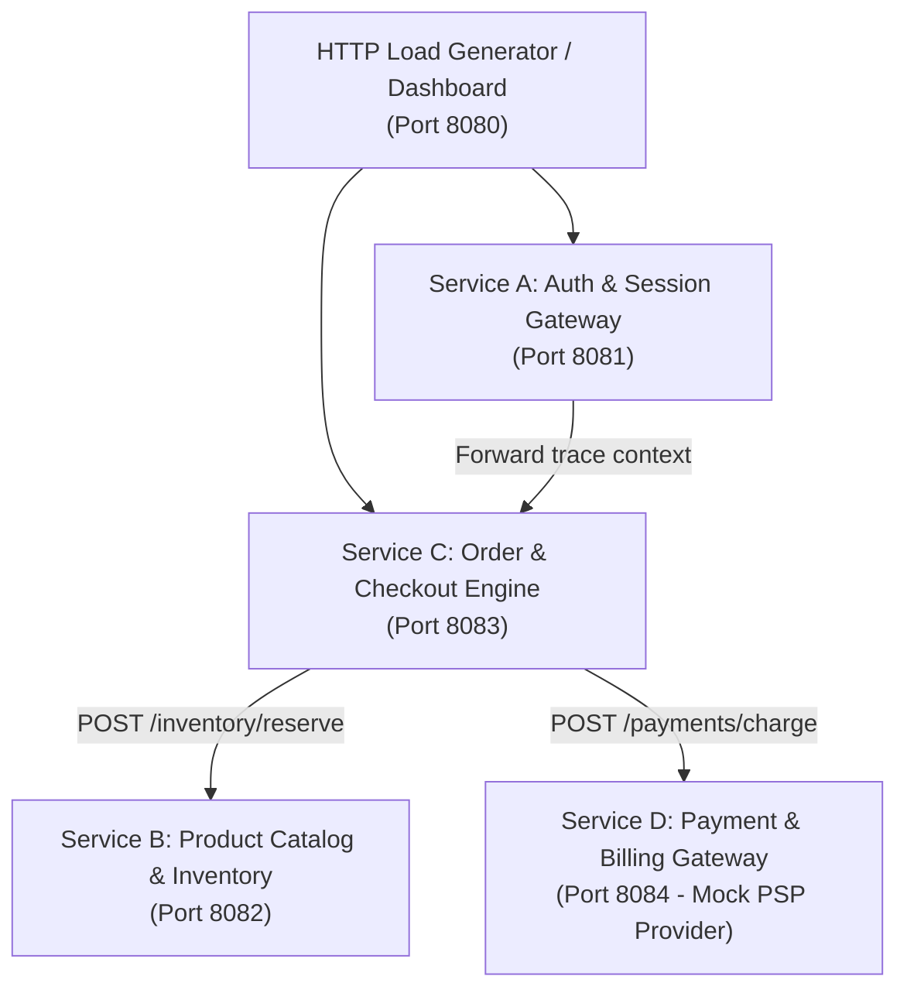

# CloudStore Skeleton

CloudStore is an educational distributed e-commerce checkout and fulfillment backend designed for the **ISEN5 Software Operations & Reliability Engineering** course.

This repository provides the **TypeScript / Node.js 24 skeleton** across all 4 microservices along with a pre-configured, complete **Open-Source Observability Stack**.

> **Note**: As this is an educational skeleton, **business endpoints are not implemented** and return HTTP `501 Not Implemented` with detailed hints. Students implement the business logic, OpenTelemetry distributed tracing, RED metrics, and structured logging during Lab 2 and the Squad Integration phases.

---

## Architecture & Topology



---

## Microservice Contracts & Ports

| Service | Port | Endpoint | Method | Status in Skeleton | Description |
|---|---|---|---|---|---|
| **Service A: Auth** | 8081 | `/healthz` | `GET` | `200 OK` | Operational health probe |
| | | `/metrics` | `GET` | `501 Not Implemented` | Prometheus metrics exposition (To be implemented in Lab 2) |
| | | `/auth/login` | `POST` | `501 Not Implemented` | Accepts credentials, returns session token |
| | | `/auth/verify` | `GET` | `501 Not Implemented` | Validates `Authorization: Bearer <token>` |
| **Service B: Catalog** | 8082 | `/healthz` | `GET` | `200 OK` | Operational health probe |
| | | `/metrics` | `GET` | `501 Not Implemented` | Prometheus metrics exposition (To be implemented in Lab 2) |
| | | `/products` | `GET` | `501 Not Implemented` | Returns product catalog and stock levels |
| | | `/inventory/reserve` | `POST` | `501 Not Implemented` | Locks inventory for requested order items |
| | | `/inventory/release` | `POST` | `501 Not Implemented` | Releases reserved stock on checkout failure |
| **Service C: Order** | 8083 | `/healthz` | `GET` | `200 OK` | Operational health probe |
| | | `/metrics` | `GET` | `501 Not Implemented` | Prometheus metrics exposition (To be implemented in Lab 2) |
| | | `/orders/checkout` | `POST` | `501 Not Implemented` | Coordinates checkout saga across A, B, and D |
| **Service D: Payment** | 8084 | `/healthz` | `GET` | `200 OK` | Operational health probe |
| | | `/metrics` | `GET` | `501 Not Implemented` | Prometheus metrics exposition (To be implemented in Lab 2) |
| | | `/payments/charge` | `POST` | `501 Not Implemented` | Authorizes payment with idempotency key |

---

## Traffic & Load Generator (Port 8080)

Located in `cloudstore/load-generator/`, this interactive dashboard simulates synthetic client workloads akin to `error-rate-visu`:

- **Web Dashboard**: Access at **[http://localhost:8080](http://localhost:8080)**.
- **Scenario Presets**:
  - *Full Checkout Saga*: Simulates complete customer purchase journeys through Service C.
  - *Catalog Browsing*: Background browsing of product inventory and user sessions.
  - *Peak Shopping Surge*: High-concurrency traffic surge to test queueing and latency under load.
  - *Out-of-Stock (409)*: Requests depleted stock to test `409 Conflict` and compensating sagas.
  - *Custom Endpoint*: Directly ping any specific microservice route.
- **Zero Observability in Generator**: The load generator contains no telemetry libraries; all metrics, traces, and logs are measured on the microservices by the students.

---

## Observability Stack

The `docker-compose.yml` provisions the mandatory observability tools:

- **OpenTelemetry Collector (`otel-collector`)**:
  - `4317` (gRPC OTLP receiver)
  - `4318` (HTTP OTLP receiver)
  - `8889` (Prometheus exporter endpoint)
- **Prometheus (`prometheus:v2.54.0`)**: `http://localhost:9090`
  - Scrapes metrics from `/metrics` across all 4 microservices and the OTel Collector.
- **Jaeger UI (`jaegertracing/all-in-one:1.58`)**: `http://localhost:16686`
  - Visualizes distributed trace waterfalls.
- **Grafana Loki (`grafana/loki:3.1.0`)**: `http://localhost:3100`
  - Ingests structured JSON logs tagged with `service.name`, `environment`, and `trace_id`.
- **Grafana (`grafana:11.1.0`)**: `http://localhost:3000` (User: `admin` / Password: `admin`)
  - Pre-configured datasources for Prometheus, Jaeger, and Loki.

---

## Getting Started

### 1. Prerequisites
- Docker & Docker Compose
- Node.js 24+ & npm (for local development)

### 2. Run with Docker Compose
From the `cloudstore/` directory:
```bash
docker compose up --build
```


#### Access URLs

| Component | URL | Description |
|---|---|---|
| **Load Generator UI** | [http://localhost:8080](http://localhost:8080) | Interactive scenario traffic generator |
| **Service A (Auth)** | [http://localhost:8081](http://localhost:8081/healthz) | Auth & Session Gateway |
| **Service B (Catalog)** | [http://localhost:8082](http://localhost:8082/healthz) | Product Catalog & Inventory |
| **Service C (Order)** | [http://localhost:8083](http://localhost:8083/healthz) | Order & Checkout Engine |
| **Service D (Payment)** | [http://localhost:8084](http://localhost:8084/healthz) | Payment & Billing Gateway Mock |
| **Grafana Dashboard** | [http://localhost:3000](http://localhost:3000) | Squad executive SLO dashboard (`admin` / `admin`) |
| **Jaeger UI** | [http://localhost:16686](http://localhost:16686) | Distributed trace waterfall search |
| **Prometheus UI** | [http://localhost:9090](http://localhost:9090) | PromQL query browser & scrape targets |

Verify service health:
```bash
curl http://localhost:8081/healthz
curl http://localhost:8082/healthz
curl http://localhost:8083/healthz
curl http://localhost:8084/healthz
```

Inspect metrics (returns 501 until implemented in Lab 2):
```bash
curl -i http://localhost:8081/metrics
```

Test skeleton endpoint:
```bash
curl -i http://localhost:8081/auth/verify
# Returns: HTTP/1.1 501 Not Implemented
```

### 3. Local Development Mode (Individual Microservice)
To develop your assigned microservice locally without Docker:
```bash
cd services/service-a-auth
npm install
npm run dev
```
The server will start with hot-reloading on port 8081.

### 4. Build Verification
To compile TypeScript across services:
```bash
cd services/service-a-auth && npm run build
```
